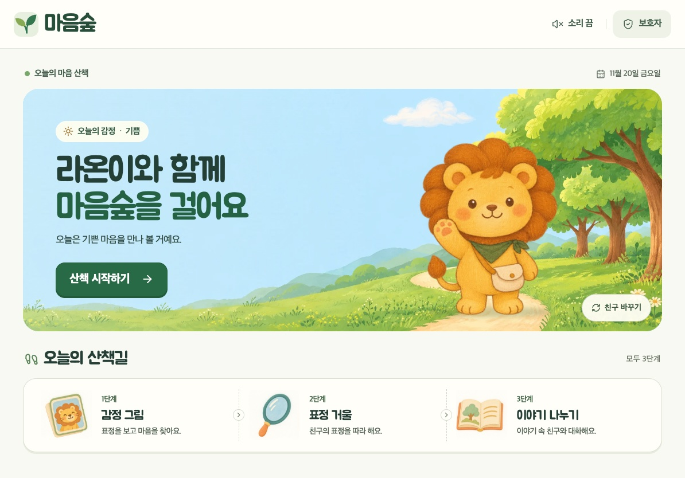
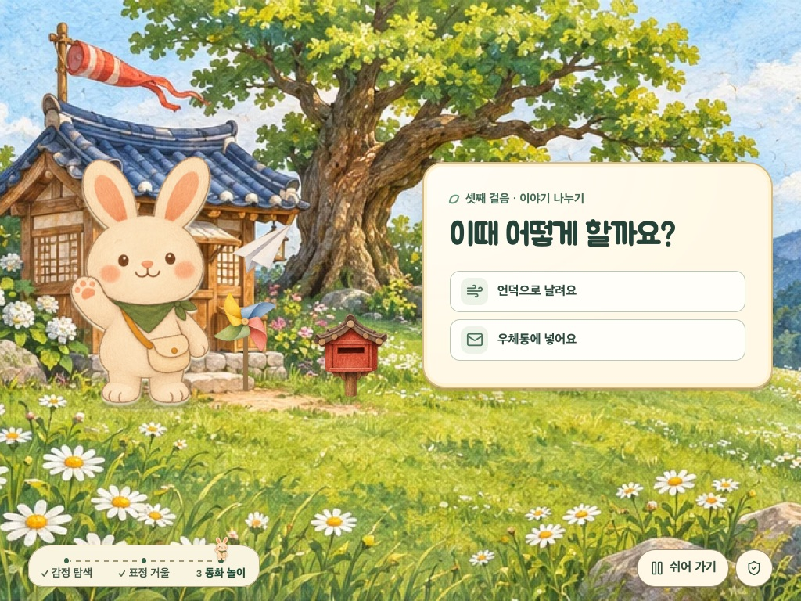

# ai-ladies-class
인공지능산업체특강 6팀 - 인공지능숙녀특강

<div align="center">

# AI 기반 감정 이해·사회적 의사소통 학습 플랫폼

### 아이의 방식과 속도에 맞춰, 함께 배우는 감정과 소통

자폐 스펙트럼 아동이 친근한 캐릭터와 함께 **감정을 알아보고, 표정을 연습하고, 일상 속 의사표현을 익히는** 맞춤형 웹 학습 플랫폼입니다.  
보호자와 교사는 학습 기록과 추천 이유를 확인하며 아동의 학습을 함께 지원할 수 있습니다.



</div>

<br />

## 마음숲 프론트엔드

아이패드에서 하루에 한 가지 감정을 만나는 한국어 웹 앱입니다. 숲 입구의 버튼 하나를 누르면 사자 라온이 오솔길로 걸어갑니다. 토끼 보리나 곰 두리로 바꿀 수 있고, 직접 꾸민 친구가 화면 위쪽 가운데의 숲길에서 다음 정거장으로 이동합니다. 아이패드에서 동작 줄이기를 켜면 바로 진행합니다. 시작하기 → 부모님 동행 확인 → 혼자라면 부모님 부르기 → 부모님 이메일 → 숫자 4자리 비밀번호 → 학습 진단 → 학습 시작하기 → 1번 학습 순서로 진행합니다.

**감정 알아보기 → 표정 거울 → 동화 속 역할놀이 → 칭찬과 스티커판**

하루 산책은 약 5분 분량으로, 아이가 직접 다음 장면을 엽니다. 감정의 뜻을 먼저 알아보고, 숲속 물건을 움직여 친구의 표정에 어떤 변화가 생겼는지 살핍니다. 표정 거울에서 연습하면 오늘의 동화가 세 장에 걸쳐 펼쳐집니다. 아이는 이야기 속 상황을 살펴보고 행동을 골라 그 결과를 볼 수 있습니다. 예를 들어 기쁨 동화 《바람 우체국의 첫 편지》에서는 종이비행기 초대장을 어디로 보낼지 정합니다. 그다음 그림이 붙은 두 문구 중 친구에게 하고 싶은 말을 고릅니다. 친구의 답을 읽고 한 번 더 이야기하거나 산책을 마칠 수 있습니다.



오른쪽 위에서 잠깐 쉬거나 방패 아이콘으로 보호자 설정을 열 수 있습니다. 보호자 설정의 ‘학습 리포트’에서 최근 마친 산책을 확인하고 가입할 때 입력한 주소로 메일 초안을 열 수 있습니다. 최종 전송은 메일 앱에서 진행합니다. 학습을 마친 뒤에는 입구의 ‘오늘 학습 다시 하기’로 같은 감정을 몇 번이든 연습할 수 있습니다. 스티커는 하루에 하나씩 모입니다.

안내와 동화는 기기의 한국어 음성으로 들을 수 있습니다. 동물 친구는 눈을 깜빡이고 말하는 동안 입을 움직입니다. 동화에서는 기기 내 한국어 음성 인식을 지원하는 경우 화면의 보기를 말로 답할 수 있습니다.

준비 산책과 감정 학습은 네 가지 감정을 표현한 인물 그림 카드로 진행합니다. 표정 거울에서는 사람 표정을 보며 연습하고 원하면 카메라로 내 모습을 확인합니다. 카메라를 건너뛰고도 터치만으로 스티커까지 받을 수 있습니다. 실제 계정 인증과 데이터 동기화, AI 생성 대화 및 표정 유사도 채점은 백엔드·AI 연동 단계에 해당합니다.

```sh
cd frontend
npm ci
npm run dev
```

Node.js 22.12 이상을 권장합니다. `npm test`로 진행 상태를 검증하고 `npm run build`로 정적 웹 파일을 생성합니다. 실제 iPad에서 카메라 권한을 요청할 때는 HTTPS로 접속합니다. [앱 구현 계획](./PRD.md) · [프론트엔드 개발 지침](./AGENTS.md)

## 배포 순서 (Azure, 준비만 함)

아직 실제로 배포하지 않았습니다. 필요한 파일과 순서만 준비했습니다. 비밀값은 저장소에 넣지 않고 Azure 앱 설정과 GitHub Secrets에만 둡니다.

| 파일 | 내용 |
| --- | --- |
| `backend/startup.sh` | App Service 시작 명령. `STORE=cosmos`일 때만 워커 여러 개(`WEB_CONCURRENCY`, 기본 2), 메모리 저장소면 1개 |
| `frontend/public/staticwebapp.config.json` | Static Web Apps 설정. 빌드하면 `dist/`에 들어감. 얼굴 모델(`.task`)·WASM 형식, 카메라·마이크는 같은 출처만 |
| `.github/workflows/backend-appservice.yml` | 백엔드 테스트 → zip → App Service (초안, Actions에서 직접 실행할 때만) |
| `.github/workflows/frontend-staticwebapp.yml` | 프론트 테스트 → 빌드 → Static Web Apps (초안, 직접 실행할 때만) |

1. **Azure 리소스 만들기**: Cosmos DB(NoSQL), App Service(Linux, Python 3.12), Static Web Apps. 대화에 AI를 쓰려면 Azure OpenAI, AI Language, AI Content Safety.
2. **App Service 앱 설정** (이름은 `backend/.env.example`과 같음)
   - `STORE=cosmos`, `COSMOS_ENDPOINT`, `COSMOS_KEY`, `COSMOS_DATABASE`
   - `JWT_SECRET` (`python -c "import secrets; print(secrets.token_urlsafe(48))"`로 만든 값)
   - `CORS_ORIGINS=https://<Static Web Apps 주소>`
   - (선택) `AZURE_OPENAI_*`, `AZURE_LANGUAGE_*`, `AZURE_CONTENT_SAFETY_*`. 비워 두면 대본과 그림 선택으로 동작
   - `SCM_DO_BUILD_DURING_DEPLOYMENT=true` (올릴 때 `requirements.txt` 설치)
   - 시작 명령 `sh startup.sh`, 상태 확인 경로 `/health`
3. **GitHub 설정**
   - Secrets: `AZURE_WEBAPP_PUBLISH_PROFILE`, `AZURE_STATIC_WEB_APPS_API_TOKEN`
   - Variables: `AZURE_WEBAPP_NAME`, `VITE_API_URL=https://<앱 이름>.azurewebsites.net`
4. **백엔드 먼저 올리기**: Actions에서 `backend (App Service) - draft` 실행 → `https://<앱 이름>.azurewebsites.net/health`에서 `store`가 `cosmos`, `auth`가 `true`인지 봅니다.
5. **프론트 올리기**: `frontend (Static Web Apps) - draft` 실행. `VITE_API_URL`은 빌드할 때 들어가므로 주소가 바뀌면 다시 실행합니다.
   - 프론트 빌드에 `backend/app/content`(감정·동화 JSON)가 필요합니다. 그래서 워크플로가 저장소 전체를 받아 빌드하고, Static Web Apps에는 `frontend/dist`만 올립니다.
6. **확인**: iPad Safari에서 HTTPS 주소로 첫 방문부터 스티커판까지 진행하고, 보호자 가입 → 학습 대시보드를 봅니다.

## 🌱 About the Project

표정을 구분하는 방법도, 생각을 표현하는 방법도 아동마다 다릅니다.  
이 프로젝트는 **한 가지 정답이나 학습 속도를 강요하기보다**, 다양한 입력 방식과 반복 가능한 활동을 통해 아동이 편안하게 감정과 의사소통을 연습하는 경험을 만드는 데 초점을 맞춥니다.

| 아동에게 | 보호자에게 | 교사에게 |
| :--- | :--- | :--- |
| 캐릭터와 함께하는 단계별 학습 | 아동별 학습 기록과 변화 확인 | 허용된 아동의 학습 과정 확인 |
| 그림과 문구를 골라 의사표현 | 활동 및 감각 설정 조정 | 학습 미션의 순서 조정 |
| 반복 연습과 긍정적 피드백 | 추천 활동과 추천 이유 확인 | 상담·지도에 참고할 학습 기록 |

## ✨ 팀 전체 기능 계획

아래는 백엔드와 AI를 포함한 팀의 기획 내용입니다.

### 01. 🪞 Mirror — 표정 따라 하기

캐릭터가 보여주는 **기쁨·슬픔·놀람·화남** 표정을 따라 하며 얼굴 움직임과 표정의 특징을 연습합니다.

- **MediaPipe Face Landmarker**의 얼굴 랜드마크·블렌드셰이프를 활용한 표정 비교
- 목표 표정과의 시각적 유사도 및 구체적인 피드백 제공
- 카메라를 사용하지 않을 때는 **표정 카드 고르기** 활동으로 대체

### 02. 🎭 Emotion Quiz — 감정 이미지 학습

얼굴 이미지와 상황 그림을 보고 감정을 구분하는 학습 활동입니다.

- **캐릭터 표정 → 인물 사진 → 표정이 포함된 상황 그림**으로 이어지는 단계별 구성
- 난이도별 선택지와 눈·입·눈썹 특징을 알려 주는 힌트 제공
- 이미지 분류 모델을 활용한 퀴즈 난이도 분석 및 취약 감정 반복 연습

### 03. 💬 AI Conversation — 상황 대화하기

친구에게 장난감을 빌리거나 도움이 필요할 때처럼 일상에서 마주하는 상황을 캐릭터와 연습합니다.

- **그림과 문구 선택**으로 캐릭터에게 응답
- **Azure OpenAI** 기반 상황별 응답 생성 계획 (초기안의 Azure AI Speech 음성 입출력은 현재 프론트엔드에서 제외)
- 연습 목표에 따른 대화 진행, 대화 범위 제한 및 안전성 검사

### 04. 🎯 하루 한 감정 산책

준비 산책에서 선택한 수준에 맞춰 한 가지 감정을 그림, 표정, 이야기로 이어서 연습합니다. 아이가 쉬거나 브라우저를 다시 열어도 진행 중인 단계에서 이어갈 수 있습니다.

### 05. 📊 Learning Report — 학습 과정 기록

학습 결과만이 아니라 **어떻게 참여하고 표현했는지**를 기록합니다.

- 활동별 학습 횟수, 정답률, 표정 연습 기록, 힌트 사용 현황
- 주간·전체 학습 흐름 및 상황 대화 기록 확인
- 보호자가 열람을 허용한 교사에게만 학습 기록 공유

### 06. ✅ Content Review — 교육 콘텐츠 검수

AI가 생성한 퀴즈 이미지와 상황 카드도 관리자가 확인한 뒤 학습에 활용할 수 있도록 구성합니다.

- 콘텐츠 초안 생성·등록 및 승인/반려 관리
- 감정 분류 결과를 참고한 퀴즈 난이도·복수 정답 검토
- 생성 정보와 검수 이력 기록

## 🔄 사용자 흐름

처음 방문하면 시작하기 → 부모님 동행 확인 → 혼자라면 부모님 부르기 → 부모님 이메일 → 숫자 4자리 비밀번호 → 학습 진단 → 학습 시작하기 → 1번 학습 순서로 진행합니다. 보호자 메뉴에서 숲 친구를 꾸미고 스티커로 복습할 수 있습니다.

**사용자별 경험**

| 사용자 | 이용 내용 |
| :--- | :--- |
| **아동** | 감정 그림 → 표정 거울 → 이야기 나누기 → 보상 확인 |
| **보호자** | 아동 프로필 및 감각 설정, 학습 리포트, 추천 순서 조정, 교사 연결 |
| **교사** | 연결이 허용된 아동의 학습 기록 및 추천 내역 확인 |
| **관리자** | 퀴즈·상황 카드 등록, AI 생성 콘텐츠 검수 및 승인 |

## 🛠️ Tech Stack

| 영역 | 기술 |
| :--- | :--- |
| **Frontend** | React · Vite · CSS · MediaPipe Tasks Vision |
| **Backend** | Python · FastAPI |
| **Computer Vision** | PyTorch · MediaPipe Tasks Vision · ONNX Runtime |
| **AI / ML** | Azure Machine Learning · Azure OpenAI |
| **언어·안전성 (팀 계획)** | Azure AI Language · Azure AI Content Safety |
| **Database & Storage** | Azure Cosmos DB · Azure Blob Storage |
| **Auth & Cloud** | Microsoft Entra External ID · Azure App Service · Azure Static Web Apps · GitHub Actions |

## ♿ Accessibility & Responsible AI

아동의 특성을 고려해 **선택권, 감각적 편안함, 안전한 데이터 처리**를 중요하게 다룹니다.

- **의사표현** · 아이가 그림과 짧은 문구를 직접 선택
- **동작 줄이기** · 기기 설정에 따라 캐릭터를 정지된 그림으로 표시
- **카메라 사용 선택:** 브라우저에서 얼굴 특징을 처리하고, 미동의 시 대체 학습 제공
- **개인정보 최소화** · 별명 기반 프로필, 법정대리인 및 카메라 동의 절차
- **안전한 AI 대화:** 개인정보 마스킹, 응답 필터링, 대화 범위·턴 제한
- **사람의 검토:** AI 생성 학습 콘텐츠는 관리자 승인 후 노출

학습 점수와 리포트는 **활동 참여 및 연습 기록**이며, 의학적 진단이나 임상적 평가를 목적으로 하지 않습니다.

## 👥 Team

| Part | Members | memo |
| :--- | :--- | :--- |
| **Frontend** | 효정 |
| **Backend** | 나린 · 명주 · 나은 | 키 기능 3개 + 이야기관련 |
| **AI** | 수정 |
