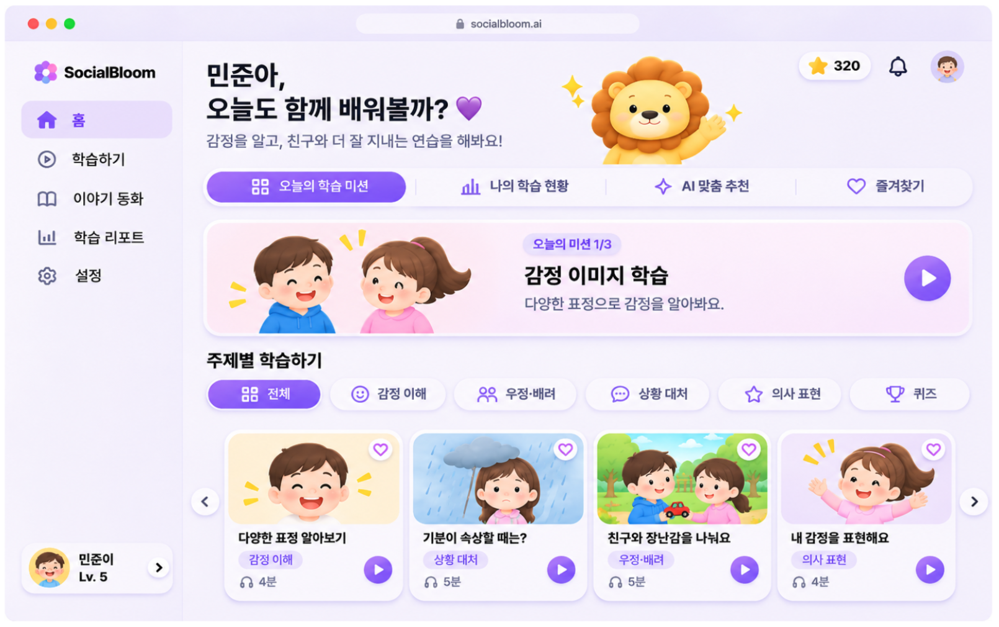
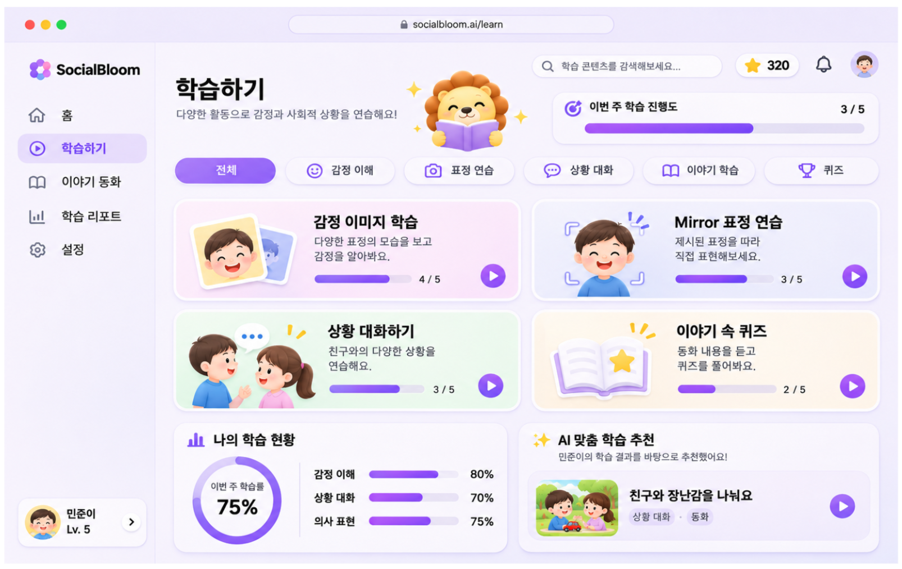
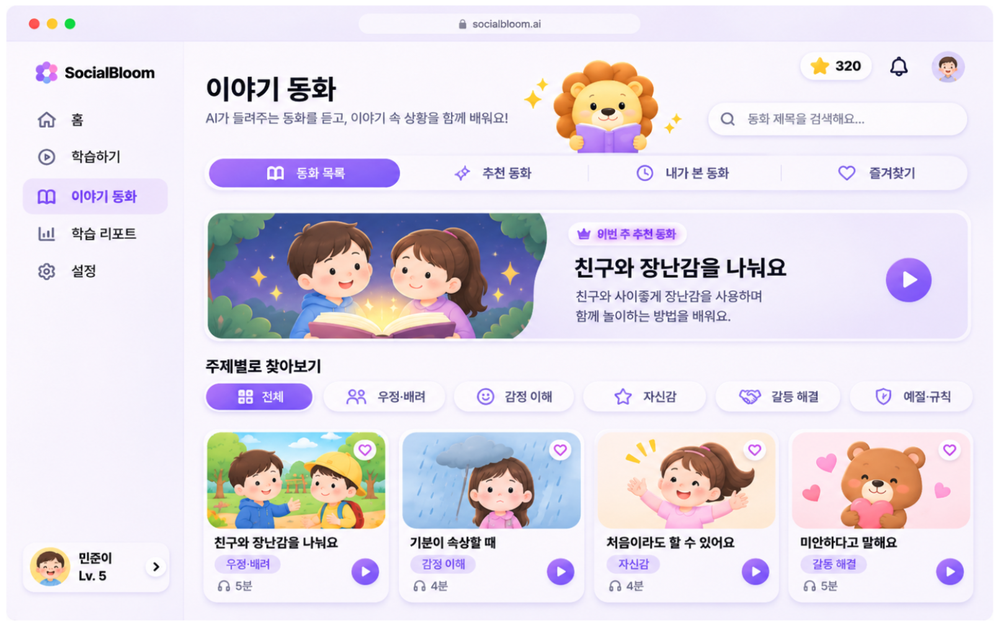
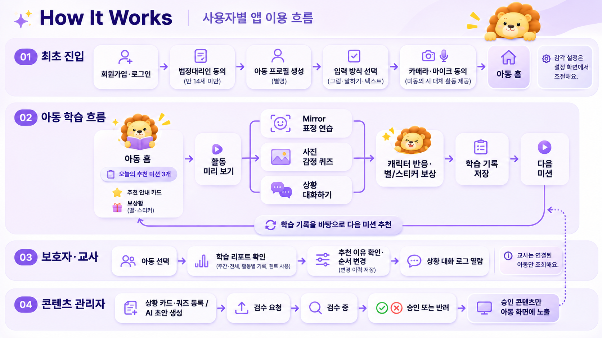

# ai-ladies-class
인공지능산업체특강 6팀 - 인공지능숙녀특강

# AI 기반 감정 이해·사회적 의사소통 학습 플랫폼

### 아이의 방식과 속도에 맞춰, 함께 배우는 감정과 소통

자폐 스펙트럼 아동이 친근한 캐릭터와 함께 **감정을 알아보고, 표정을 연습하고, 일상 속 의사표현을 익히는** 맞춤형 웹 학습 플랫폼입니다.  
보호자와 교사는 학습 기록과 추천 이유를 확인하며 아동의 학습을 함께 지원할 수 있습니다.

 

## 🌱 About the Project

표정을 구분하는 방법도, 생각을 표현하는 방법도 아동마다 다릅니다.  
이 프로젝트는 **한 가지 정답이나 학습 속도를 강요하기보다**, 다양한 입력 방식과 반복 가능한 활동을 통해 아동이 편안하게 감정과 의사소통을 연습하는 경험을 만드는 데 초점을 맞춥니다.

| 아동에게 | 보호자에게 | 교사에게 |
| :--- | :--- | :--- |
| 캐릭터와 함께하는 단계별 학습 | 아동별 학습 기록과 변화 확인 | 허용된 아동의 학습 과정 확인 |
| 그림·말하기·텍스트로 의사표현 | 활동 및 감각 설정 조정 | 학습 미션의 순서 조정 |
| 반복 연습과 긍정적 피드백 | 추천 활동과 추천 이유 확인 | 상담·지도에 참고할 학습 기록 |

## ✨ Key Features

### 01. 🪞 Mirror — 표정 따라 하기

캐릭터가 보여주는 **기쁨·슬픔·놀람·화남** 표정을 따라 하며 얼굴 움직임과 표정의 특징을 연습합니다.

- **MediaPipe Face Landmarker**의 얼굴 랜드마크·블렌드셰이프를 활용한 표정 비교
- 목표 표정과의 시각적 유사도 및 구체적인 피드백 제공
- 카메라를 사용하지 않을 때는 **표정 카드 고르기** 활동으로 대체

### 02. 🎭 Emotion Quiz — 감정 이미지 학습

얼굴 이미지와 상황 그림을 보고 감정을 구분하는 학습 활동입니다.

- **캐릭터 표정 → 인물 사진 → 표정이 포함된 상황 그림**으로 이어지는 단계별 구성
- 난이도별 선택지와 눈·입·눈썹 특징을 알려 주는 힌트 제공
- 이미지 분류 모델을 활용한 퀴즈 난이도 분석 및 취약 감정 반복 연습

### 03. 💬 AI Conversation — 상황 대화하기

친구에게 장난감을 빌리거나 도움이 필요할 때처럼 일상에서 마주하는 상황을 캐릭터와 연습합니다.

- **그림 선택**을 기본으로 말하기·텍스트 응답 지원
- **Azure OpenAI** 기반 상황별 응답 생성, **Azure AI Speech** 기반 음성 입출력
- 연습 목표에 따른 대화 진행, 대화 범위 제한 및 안전성 검사

### 04. 🎯 Personalized Learning — 오늘의 맞춤 미션

아동의 학습 과정에 따라 **하루 3개의 미션**과 학습 순서를 구성합니다.

- 정답률, 표정 연습 기록, 힌트 사용 및 반복 기록 반영
- 초기 규칙 기반 추천에서 학습 이력 기반 추천으로 확장
- 아동용 안내와 보호자·교사용 **추천 이유**를 구분해 제공

### 05. 📊 Learning Report — 학습 과정 기록

학습 결과만이 아니라 **어떻게 참여하고 표현했는지**를 기록합니다.

- 활동별 학습 횟수, 정답률, 표정 연습 기록, 힌트 사용 현황
- 주간·전체 학습 흐름 및 상황 대화 기록 확인
- 보호자가 열람을 허용한 교사에게만 학습 기록 공유

### 06. ✅ Content Review — 교육 콘텐츠 검수

AI가 생성한 퀴즈 이미지와 상황 카드도 관리자가 확인한 뒤 학습에 활용할 수 있도록 구성합니다.

- 콘텐츠 초안 생성·등록 및 승인/반려 관리
- 감정 분류 결과를 참고한 퀴즈 난이도·복수 정답 검토
- 생성 정보와 검수 이력 기록

## 🖥️ Service Preview

### Learning — 다양한 방식으로 배우기

감정 이미지 학습, Mirror 표정 연습, 상황 대화, 이야기 학습 등 활동을 탐색하고 나의 학습 현황을 확인하는 화면입니다.

### Storybook — 이야기를 통해 익히기

동화 속 인물과 상황을 살펴보며 감정, 배려, 갈등 해결과 같은 주제를 접하는 이야기 학습 영역입니다.

## 🔄 How It Works

**사용자별 경험**

| 사용자 | 이용 내용 |
| :--- | :--- |
| **아동** | 활동 선택, 감정 학습, 상황 대화, 보상 확인 |
| **보호자** | 아동 프로필 및 감각 설정, 학습 리포트, 추천 순서 조정, 교사 연결 |
| **교사** | 연결이 허용된 아동의 학습 기록 및 추천 내역 확인 |
| **관리자** | 퀴즈·상황 카드 등록, AI 생성 콘텐츠 검수 및 승인 |

## 🛠️ Tech Stack

| 영역 | 기술 |
| :--- | :--- |
| **Frontend** | React · Vite · Tailwind CSS · Recharts |
| **Backend** | Python · FastAPI |
| **Computer Vision** | PyTorch · MediaPipe Tasks Vision · ONNX Runtime |
| **AI / ML** | Azure Machine Learning · Azure OpenAI |
| **Speech & Safety** | Azure AI Speech · Azure AI Language · Azure AI Content Safety |
| **Database & Storage** | Azure Cosmos DB · Azure Blob Storage |
| **Auth & Cloud** | Microsoft Entra External ID · Azure App Service · Azure Static Web Apps · GitHub Actions |

## ♿ Accessibility & Responsible AI

아동의 특성을 고려해 **선택권, 감각적 편안함, 안전한 데이터 처리**를 중요하게 다룹니다.

- **다양한 상호작용:** 그림 선택을 기본으로 음성·텍스트 입력 선택 가능
- **감각 설정:** 효과음, 애니메이션, 캐릭터 표현 강도 조절
- **카메라 사용 선택:** 브라우저에서 얼굴 특징을 처리하고, 미동의 시 대체 학습 제공
- **개인정보 최소화:** 별명 기반 프로필, 법정대리인 및 카메라·마이크 동의 절차
- **안전한 AI 대화:** 개인정보 마스킹, 응답 필터링, 대화 범위·턴 제한
- **사람의 검토:** AI 생성 학습 콘텐츠는 관리자 승인 후 노출

학습 점수와 리포트는 **활동 참여 및 연습 기록**이며, 의학적 진단이나 임상적 평가를 목적으로 하지 않습니다.

## 👥 Team

| Part | Members | memo |
| :--- | :--- | :--- |
| **Frontend** | 효정 |
| **Backend** | 나린 · 명주 · 나은 | 키 기능 3개 + 이야기관련 |
| **AI** | 수정 |
